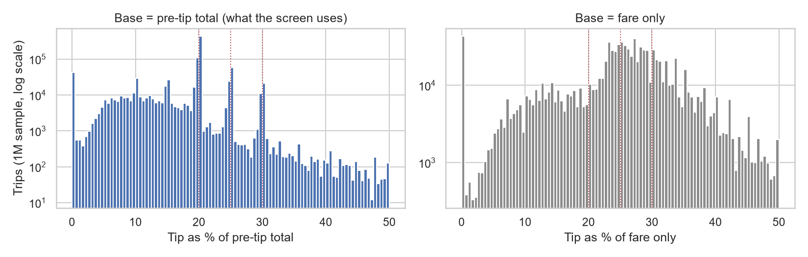
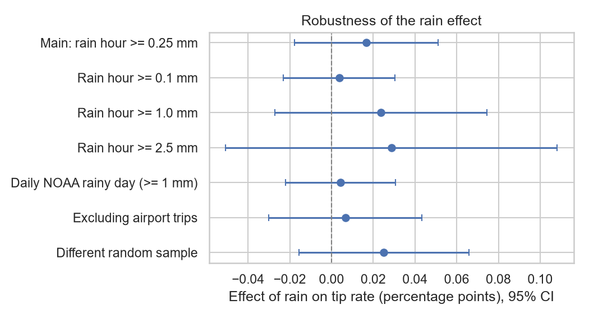

# Does Rain Change How NYC Taxi Passengers Tip?

An inferential-statistics study of **29.4 million** card-paid NYC Yellow Taxi trips in 2024, matched to hourly
weather data. It asks whether passengers tip a different share of the fare when it is raining at pickup.

**Short answer: no.** After controlling for time, trip characteristics and temperature, rain at pickup changes
the tip rate by **+0.02 percentage points (95% CI −0.02 to +0.05)** on a mean of 17.8%. This is a *precisely
estimated null*: the confidence interval rules out effects larger than ~0.3% of the average tip rate. A likely
reason is that **46% of all card trips tip exactly 20%**, the preset button on the in-cab payment screen.

📄 **Report:** [`report/report.tex`](report/report.tex) (4-page write-up)

## Key findings

| | Result |
|---|---|
| Average tip, April 2024 (pilot) | \$4.31, 95% CI [\$4.20, \$4.42]; t-interval and bootstrap agree |
| Rain effect on tip rate (pickup hour, full controls, SE clustered by day) | +0.017 pp, 95% CI [−0.018, +0.051], p = 0.34 |
| Same, with no controls | +0.090 pp, p = 0.003, which is **confounded** by when it rains |
| Lower dollar tips on rainy days | −\$0.045 (p = 0.009), which disappears once the day's trip mix is controlled for (**composition effect**) |
| Trips tipping exactly 20% of the pre-tip total | 46.4% of card trips (56% of tippers) |
| Rain-measure validation (ERA5 vs NOAA station) | r = 0.83, 89% agreement on rainy-day labels |

<p align="center">
  <br>
  <em>Tip rates bunch at the 20/25/30% preset buttons, but only when measured against the pre-tip total the screen uses.</em>
</p>
<p align="center">
  <br>
  <em>The rain effect stays close to zero under every specification.</em>
</p>

## Approach

1. **Pilot (`notebooks/01_ci_tip_april.ipynb`).** One month of data. A 95% confidence interval for the mean tip
   (t-interval checked with a bootstrap, because tips are right-skewed), plus a rainy-vs-dry-day comparison
   (Welch's t-test, Mann-Whitney U, Cohen's d). The result was not significant, but a power analysis shows that
   with 15 vs 15 days only effects of d ≥ 1.06 were detectable, so the pilot could not answer the question.
2. **Full-year study (`notebooks/02_rain_effect_2024.ipynb`).**
   - **Data.** All 12 months of 2024, cleaned with documented rules (card payments only, because cash tips are
     not recorded; standard or JFK rate; plausible fare, distance and duration).
   - **Measurement.** The tip rate is measured on the pre-tip total, the base used by the payment screen,
     which the data show is the right base. Rain comes from ERA5 hourly reanalysis and is validated against
     the NOAA Central Park station.
   - **Day-level tests.** The pilot's tests repeated with 366 days (minimum detectable effect d = 0.32).
   - **Confounding check.** A χ² test shows rain is unevenly spread across months.
   - **Regression.** OLS of the tip rate on rain at the pickup hour, with hour, weekday and month fixed effects,
     a holiday dummy, temperature, log distance, log duration, airport and passenger controls. Standard errors
     are clustered by day (366 clusters), because trips on the same day share the same weather.
   - **Margins.** Separate models for whether a passenger tips, the tip rate among tippers, and choosing
     exactly 20%.
   - **Robustness.** Rain thresholds from 0.1 to 2.5 mm/h, continuous intensity, station-based daily rain,
     alternative outcomes, excluding airport trips, and a second random sample.

## Repository structure

```
├── notebooks/
│   ├── 01_ci_tip_april.ipynb       # pilot: CI for mean tip + rainy-vs-dry test (April 2024)
│   └── 02_rain_effect_2024.ipynb   # main study: full year, regression, robustness
├── src/
│   ├── download_data.py            # downloads taxi + weather data into data/raw/
│   └── prepare_data.py             # cleaning, feature engineering, weather join -> data/processed/
├── figures/                        # all figures produced by the notebooks
├── report/                         # LaTeX report (compile on Overleaf)
├── data/                           # created by the scripts, not tracked by git
└── requirements.txt
```

## Reproducing the results

```bash
python -m venv .venv
source .venv/bin/activate        # Windows: .venv\Scripts\activate
pip install -r requirements.txt

python src/download_data.py      # ~700 MB: 12 monthly TLC files + weather
python src/prepare_data.py       # ~5 min, writes data/processed/
jupyter notebook notebooks/      # run 01 and 02 top to bottom (02 takes ~20 min)
```

Requirements: Python 3.11 or newer and about 8 GB of RAM. All random sampling uses fixed seeds.

## Data sources

- **NYC Taxi & Limousine Commission:** [Yellow Taxi Trip Records](https://www.nyc.gov/site/tlc/about/tlc-trip-record-data.page), January–December 2024.
- **Open-Meteo:** [Historical Weather API](https://open-meteo.com/en/docs/historical-weather-api) (ERA5 reanalysis), hourly precipitation and temperature at the Central Park grid point.
- **NOAA NCEI:** [GHCN-Daily](https://www.ncei.noaa.gov/products/land-based-station/global-historical-climatology-network-daily), station USW00094728 (Central Park), daily precipitation, used for validation.

## Limitations

The data cover card trips only; rain is measured at a single point; and the design is observational.
See Section 8 of notebook 02 and the report for a full discussion.
